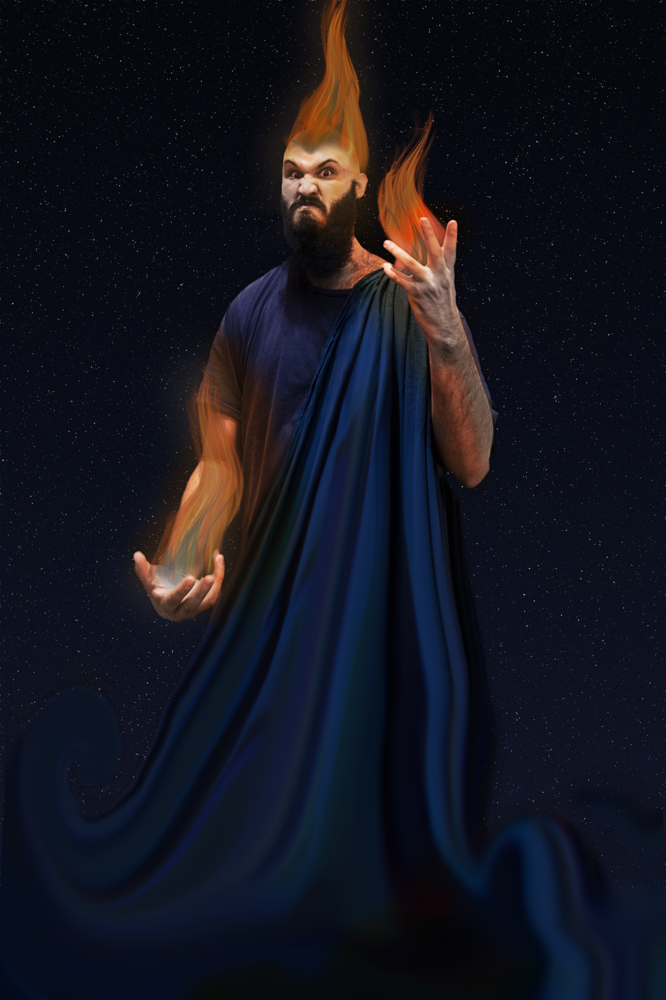

<link rel="preconnect" href="https://fonts.googleapis.com">
<link rel="preconnect" href="https://fonts.gstatic.com" crossorigin>
<link href="https://fonts.googleapis.com/css2?family=EB+Garamond:ital,wght@0,400..800;1,400..800&display=swap" rel="stylesheet">

> Para todos verem: um sujeito com cabelos de fogo e fogo saindo pelas mãos. Veste algo como uma toga azul escura e tem o céu estrelado de mesma cor ao fundo. Sou eu fazendo *cosplay* do personagem Hades do filme Hércules da Disney.

# A Tecnologização Do Sagrado E A Crise Do Indivíduo Contemporâneo[^1]

## Sumário

1. Resumo
2. Introdução
3. Análise conceitual
4. Enquadramento Teórico
5. Análise
6. Discussão
7. O sagrado contemporâneo
8. Conclusão

## Resumo

Este ensaio investiga a transformação contemporânea do lugar do sagrado nas sociedades ocidentais. Partindo da distinção entre religião institucional, experiência religiosa e mito social, o estudo propõe que a modernidade não elimina o sagrado, mas desloca seus mecanismos de mediação. Apoiado nas contribuições de Marshall McLuhan e Pierre Bourdieu, o conceito de tecnologia é compreendido como extensão cognitiva e estrutura simbólica capaz de organizar percepções coletivas e formas de pertencimento. Argumenta-se que a crise do indivíduo contemporâneo não decorre da secularização propriamente dita, mas da multiplicação concorrente de formas de sacralidade mediadas por tecnologias comunicacionais e desprovidas de autoridade comum. A personalização algorítmica das mídias contribui para a atomização social e para a substituição parcial das funções integradoras anteriormente desempenhadas pela religião. Conclui-se que a condição pós-secular caracteriza-se não pela ausência de crença, mas pela impossibilidade de crença inocente, produzindo um indivíduo simultaneamente plural em convicções e estruturalmente isolado.
{: .capitular}

Palavras-chave: #Secularização, #Tecnologia, #Sagrado, #Crise_da_Contemporaneidade
## Introdução

A hipótese de trabalho para esse ensaio caracteriza-se pela frase "A crise não decorre da secularização, mas da multiplicação de sacralidades sem autoridade comum". E embora o ensaio apresente um raciocínio linear e aparentemente sugira uma evolução gradual e crescente dos eventos históricos, é preciso ter como horizonte todas as contradições apresentadas ao longo da história para cada afirmação cabal aqui apresentada. "O indivíduo medieval não questionava" tratar-se-ia de um engodo se não fosse uma estratégia de síntese para a preservação da narrativa. Sabe-se que todos os tempos têm suas histórias dissidentes e tratar-se-á aqui da história institucional e da institucionalização do pensamento. Trata-se de um ensaio e não se pretende explicar a civilização inteira em alguns parágrafos. Esse ensaio assume caráter interpretativo e não empírico.
{: .capitular}

Questiona-se, portanto: Como a mediação tecnológica altera a autoridade coletiva simbólica? Por que a pluralização de sacralidades gera uma crise individual? O que distingue a mediação tecnológica da experiência religiosa?

## Análise Conceitual

Para adentrar o que vem a seguir é necessário que se distinga separadamente as seguintes categorias: (1) Religião institucional: Aquela firmada sobre uma instituição representativa (Quem exerce o poder?), como a Igreja Católica; (2) Experiência religiosa: Aquela que o indivíduo testa em seu íntimo (Como o indivíduo atribui sentido?); (3) Mito social: aquele que serve à coesão narrativa de uma comunidade (Como sociedades se mantêm coesas?).
{: .capitular}

Ainda, para falar de tecnologia, lança-se mão de McLuhan ao tê-la como extensão do ser humano e de sua forma de pensar. Considera-se a forma de pensar também articulada ao conceito de Bourdieu de "capital cultural", no qual a cultura é tomada como uma categoria qualificável conforme a estrutura social: alta cultura, baixa cultura. Em síntese, tecnologia está além da manifestação visível e paupável, embora ainda também o seja, mas aqui interessa a relação cognitiva, abstracional e conceitual da técnica que se revela pela mídia material. Em outras palavras, a tecnologia como framework ou como atitude cognitiva ou como mindset é a dimensão focal do presente ensaio. Em síntese, *tecnologia é, aqui, a manifestação material e estruturada em larga escala de um sistema simbólico capaz de organizar a percepção coletiva.* 

## Enquadramento teórico

Este ensaio é uma tentativa de síntese de leituras e reflexões acerca do estado de espírito do indivíduo chamado ocidental. Frente à ideia de religião institucional e o papel que esta ocupa em sua identidade. Há duas chaves simultâneas e não concorrentes. Esse ensaio verá religião institucional em aspecto amplo: sem diferenciar mitologia de dogma ou de religião em sentido estrito. As chaves mencionadas são (1) religião institucional como tecnologia de controle social e (2) religião como via legítima de acesso ao transcendente (experiência religiosa). O questionamento final é centrado em tentar entender qual o lugar possível para o sagrado na vida coletiva contemporânea. Afirma-se que *o contemporâneo não elimina o sagrado; mas a tecnologia desloca seus mecanismos de mediação.*
{: .capitular}

Também, dada a extensão do período selecionado para análise, define-se como foco desse trabalho a contemporaneidade. Por ser síntese e co-habitação de todos os tempos, a contemporaneidade guarda em si movimentos diversos. A seção de análise dedica-se a organizar de forma didática e não exaustiva momentos chave para a compreensão do argumento central de que *a crise do indivíduo contemporâneo não decorre da perda da religião institucional, mas da multiplicação concorrente de formas de sacralidade sem autoridade comum.*

## Análise

Na Idade Média, quando religião e filosofia são reunidos pelo dogma desenvolvido pela igreja católica que, utilizando-se da filosofia aristotélica, buscou reconciliar o pensamento racional à fé. Dado o poder e influência alcançados pela igreja durante o período do medievo, ela passou a ditar a estrutura social europeia: a cosmologia e o que é conhecido como pirâmide social (camponeses, nobres, clero e monarquia). Tal estratificação era sustentada por diversos mecanismos mas chancelada em absoluto pela visão de mundo imposta pela igreja e não validava de qualquer modo alguma noção de mobilidade social. A institucionalidade medieval limitava os canais legítimos de dissenso.
{: .capitular}

O protestantismo, então, questiona. E rompe com a tradição. Abrindo caminho e assentando as bases para o surgimento e consolidação dos Estados contemporâneos. Tal qual os filósofos questionaram os deuses, Lutero questiona a igreja. Ao expor a corrupção pela venda de indulgências e a hipocrisia com a qual a administração clerical lidava com a fé, Lutero devolve ao indivíduo a agência de questionar. O trabalho - Antes castigo bíblico - torna-se caminho de edificação. A burguesia tem agora os preceitos filosóficos para sua ascensão e consequente mobilidade. A realidade já não é como antes. As camadas sociais revolucionam-se.

Tem-se então a Revolução Francesa, primeiras constituições, a noção de que todo indivíduo nasce igual e a separação formal entre religião institucional e Estado. O que, por si, pode gerar algum estranhamento. Dado que para muitas culturas a religião institucional é o Estado. Além disso, o que define tais fronteiras? Onde a religião institucional começa e o Estado termina? Roma e Portugal, antes disso, já usavam o mito social como narrativa de origem legitimadora (Rômulo e Remo; Camões convocando as musas do Tejo). A igreja católica e os reinos ibéricos ora se auxiliavam, ora eram inimigos (expulsão dos jesuítas do Brasil). A laicização foi, portanto, um processo lento, contraditório e cujo final não é explícito.

Considera-se agora a expansão cartográfica e o descentramento cosmológico. Galileu, em seu tempo, determina a Terra como periférica. Copérnico defende que o Sol também, em relação ao Universo. O que alarga a consciência do indivíduo desse tempo, dando a ele uma sensação de que há uma noção cosmológica cuja religião é insuficiente para abarcar e definir. A ciência ganha espaço concorrente ao mito. O mundo para esse indivíduo é grande e interconectado demais para caber em uma narrativa sagrada única. O Gênesis, livro sagrado, já não pode mais ser interpretado ao pé da letra. Abre-se caminho para um salto de abstração.

## Discussão

Chega-se ao momento presente, o contemporâneo global e a aceitação relativamente pacífica de uma noção de mobilidade de crença. Grandes cidades cosmopolitas são então como mundos dentro de nações e conectam-se entre si. O planeta já não tem as mesmas dimensões cartográficas anteriores às Grandes Navegações. Devido ao contato cotidiano com múltiplas religiões e culturas, não é anormal que alguém seja budista hoje e hindu amanhã. Ou mesmo que haja sincretismo entre tais crenças. A religião deixa de ser destino étnico e torna-se item de prateleira de identidade. Se uma religião não agrada, escolhe-se a do vizinho. Frequenta-se um outro templo.
{: .capitular}

Tais reflexões desaguam na atual crise da noção de Estado-nação. Desenvolvida por milênios. Na qual um Estado é uma nação fundada em elementos comuns, usualmente etnia, língua, mito social e religião institucional. Tal noção esgarça-se hoje. Há países já nos quais a convivência forçada de etnias e religiões institucionais diferentes no mesmo território desafiam os limites da administração pública. Discute-se hoje a existência de Estados que não sejam nações. O patriotismo mítico ("somos um povo navegante", "descendemos dos Aqueus") perdeu força operacional de cola social.

## O Sagrado Contemporâneo

Hoje o algoritmo é uma extensão mcluhaniana. Seu operador, com sua filosofia (o que o articula com a noção de Bourdieu de campo), configura-o conforme o que acredita, ainda que de forma coletiva (muitos programadores desses algoritmos pertencem a realidades sociais comuns). A partir desse raciocínio tem-se que o algoritmo é, em si, a expressão do campo simbólico e cognitivo de seu operador. Quando em relação com o usuário, põe em diálogo tal campo com a realidade e o campo simbólico e cognitivo do usuário. O meio reconfigura a mensagem (naturalmente, mas nesse caso também por via personalizável previamente programada), que reconfigura o receptor (por meio do estímulo).
{: .capitular}

A "bolha do algoritmo", ocasionada pelo efeito retroalimentado e ecoico do feedback reforçado da crença do usuário pela tecnologia, reproduz a lógica de campo defendida do Bourdieu. Grupos degladiam-se pois não há diálogo entre capitais simbólicos distintos. Em outras palavras, o que estão dentro da bolha do usuário têm capital simbólico reforçado e os que estão fora são punidos das mais diversas formas. O acesso em si à tecnologia já é motivo de ansiedade entre os indivíduos. Hoje, até mesmo o dinheiro circula digitalmente no Brasil (Pix), o que exclui virtualmente aqueles que não possuem um aparelho móvel do sistema financeiro.

Chega-se então na questão axiomática: O que ocupa o lugar dos deuses hoje? Afirma-se aqui que são as tecnologias. Tais ferramentas, extensões do homem e de sua forma de ver a realidade, cumprem a função que a religião institucional e o mito social cumpria nos tempos antigos: dar coesão, direcionar o comportamento e criar consenso. A religião institucional foi uma ferramenta e hoje há ferramentas mais eficientes.

A televisão, o youtube, os jornais, os celulares, especialmente estes últimos, são mídias altamente personalizáveis que sugerem a atomização dos indivíduos em bolhas de crenças pessoais auto-referenciadas cujo algorítimo, se seu operador bem entender, determina reforços e punições ao usuário conforme a construção de uma persona virtual do mesmo, cujos gostos, desejos, frustrações estão catalogados e discriminados.

Há um segundo questionamento. Esse, sem resposta conclusiva: Se a religião institucional pode ser uma ferramenta de conexão com o transcendente para aqueles que a utilizam de boa-fé (com a intenção de fazê-lo somente e não de "controlar" ou legitimar seu poder), esses raramente estão em posição de agência sobre o Estado e, portanto, não o controlam. Quem detém o poder, no entanto, raramente busca o transcendente de boa fé - usa o aparelho religioso instrumentalmente. Daí que esse ensaio enquadra a religião institucional e o mito social sob o conceito de "tecnologia" e "ferramenta". Assumindo uma postura metodológica e consciente de que religião, em sentido lato, pode assumir conceitos diversos. Não se esgota.

Por fim, se o príncipe não pode colocar um guarda em cada lar, pode incutir o deus em cada coração e mente. O problema que se impõe: Quem define o limite do uso legítimo dessas ferramentas? Não há resposta ética conclusiva - Eis a origem da crise.

## Conclusão

O diagnóstico final aponta para possíveis respostas das hipóteses: *o contemporâneo não elimina o sagrado; mas a tecnologia desloca seus mecanismos de mediação e a crise do indivíduo contemporâneo não decorre da perda da religião, mas da multiplicação concorrente de formas de sacralidade sem autoridade comum.*
{: .capitular}

A tecnologia produz experiência religiosa implícita? Desde o advento de transmissões de eventos religiosos até a criação de templos virtuais, passando por rituais via video-chamada durante a pandemia, caixas de orações eletrônicas etc. Devido às citadas, pode-se afirmar seguramente que a tecnologia é meio de experiência religiosa. No entanto, se a mesma produz tal experiência de maneira implícita carece de análise posterior na qual o sagrado seria melhor definido. Pode-se afirmar, no entanto, que o framework cognitivo do criador de uma tecnologia está presente e reflete-se no uso da mesma. Pois é a tecnologia extensão do homem. De modo que a compreensão cosmológica certamente se transmitirá. O que não necessariamente se dará com a experiência religiosa ou transcendente.

Mas, afinal, o que distingue a mediação tecnológica da experiência religiosa? A experiência religiosa é, em si, um fenômeno subjetivo que considera a história do indivíduo e seu estado de espírito atual. É transcendente por natureza. O contato do humano com aquilo que o supera. É descrita muitas vezes como impossível de abarcar em um conceito ou explicação. A mediação tecnológica, por sua vez, pode facilitar tal experiência, mas não pode garantí-la. A tecnologia pode simbolizar ou facilitar o acesso aos símbolos necessários para o experimentar transcendente. Daí sua diferença: uma facilita a experiência e a outra é em si a experiência, absolutamente subjetiva, por natureza.

Outra questão, que dialoga diretamente com o escopo aqui definido é "Como a mediação tecnológica altera a autoridade coletiva simbólica?". Tal mecanismo se dá em diversas camadas: a personalização da experiência simbólica, a virtualização do território de culto e, então, a dispersão do poder institucional central e da experiência coletiva fora do virtual.

A máquina, programada conforme o pensamento de seu criador, tornar-se um eco filosófico replicador de uma estrutura pré-definida na qual o usuário se vê em um jogo de espelhos: sua experiência é o centro e o produto. O território de culto torna-se virtual (orações online, video-chamadas, igrejas no Minecraft etc.) o que exclui a experiência fisicamente coletiva. Observa-se que tal coisa não é o mesmo que dizer que a experiência não é real nem coletiva.

O poder institucional não é mais uma figura central com imagem relativamente definida, mas uma quimera de várias faces: a religião institucional, ao utilizar as tecnologias, apresenta-se conforme a filosofia de cada usuário, o que aumenta sua capilaridade, mas dispersa seu poder de influência ao concorrer com todas as outras dimensões da "vida virtual" do usuário: no mesmo feed há receitas de culinária, notícias da política e orações de benção para o dia.

Para compreender agora porque a pluralização de sacralidades gera uma crise individual é preciso averiguar o mecanismo contemporâneo e como ele se dá no indivíduo. O indivíduo contemporâneo está em crise constante que, paradoxalmente, crê em tudo, mas não vê evidência de nada. Pois tudo está em suspenso em relação a subjetividade de uma nova forma de observar a questão no "templo vizinho", por assim dizer. A abordagem default do indivíduo é de um ceticismo tácito. Ele vê a religião institucional como dispositor moral, mas não como ferramenta de aglutinação social. A solidariedade entre os indivíduos, mecânica, como defendida por Durkheim, se dissolve. E o indivíduo isolado, encontra-se em constante auto-vigilância moral. A sociedade funciona, a custo do isolamento do indivíduo.

Quando muito, a religião institucional constrói pequenas seitas que degladiam-se entre si em grandes cidades e/ou países. Evangélicos vs. Umbandistas, como no Brasil. Onde é possível observar a destruição de figuras e espaços de culto. Além da apropriação da dogmática religiosa para a reconfiguração de territórios pelo crime.

A coesão social é perdida. A religião institucional e o mito social não definem mais o Estado, não define mais a cosmologia e mal define a identidade. Estão deslocados, mas o vazio deixado não é preenchido. A identidade flui como líquido (Bauman) em busca de preenchimento. O sagrado e o transcendente não perdem seu valor e sua necessidade.

Assim, emerge a questão final desse ensaio: O que pode ocupar de forma saudável e não manipulável o lugar do sagrado na vida individual e coletiva? Hoje não é mais difícil crer; mas impossível crer inocentemente. Isto é, crer sem consciência da instrumentalização da religião institucional e do mito social.

Rfz

[^1]: Rfz é pesquisador independente baseado em Brasília, Brasil. Bacharel em Comunicação – Audiovisual (Universidade de Brasília – UnB). Interesses de pesquisa incluem sistemas simbólicos pós-seculares, semiótica, teoria cultural, e os mecanismos pelos quais tecnologias de sentido organizam a percepção coletiva. Atualmente desenvolvendo o conceito de “**Purificação Simbólica**”: uma matriz para compreender como sistemas simbólicos dominantes sobrescrevem outros enquanto apresentam-se como neutros (rafzmilhomens@proton.me).
