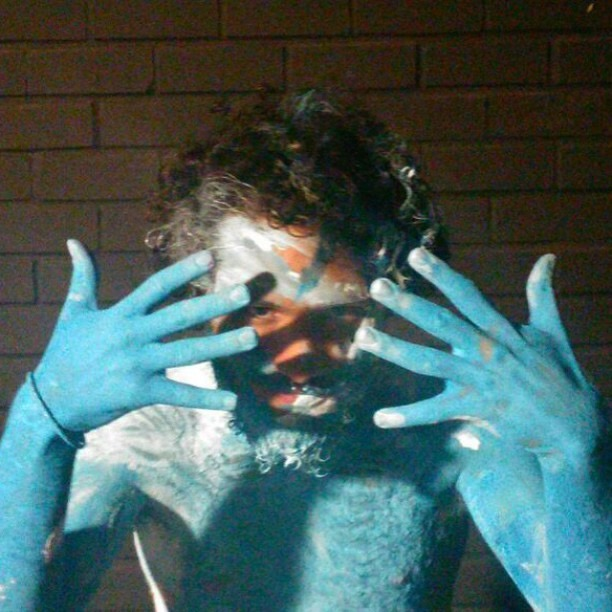

<link rel="preconnect" href="https://fonts.googleapis.com">
<link rel="preconnect" href="https://fonts.gstatic.com" crossorigin>
<link href="https://fonts.googleapis.com/css2?family=EB+Garamond:ital,wght@0,400..800;1,400..800&display=swap" rel="stylesheet">

> Para todos verem: um jovem com o corpo pintado de azul.

# Da Natureza Gentil[^1]

[RFZ O Espírito Zombeteiro](RFZ_O_Espírito_Zombeteiro)

## Sumário

1. [Introdução](#introdução)
2. [Do Real](#do-real)
3. [Da Recusa](#da-recusa)
4. [Da Humildade](#da-humildade)
5. [Da Gentileza](#da-gentileza)
6. [Conclusão](#conclusão)

## Introdução

Tenho pra mim que a realidade é inacessível em absoluto, mas está lá. E fica a questão que me intriga: que fazem os entes quando não se manifestam?
{: .capitular}

Faço um exercício comigo mesmo com frequência. Paro. Respiro fundo. Olho envolta. O lugar calmo ou barulhento, o que for: que diabos é isso aqui? De sou feito eu? De que é tudo feito? Isso me assombra. É como se o todo o universo fosse feito da mesma gota d'água e eu estivesse mergulhado como a gota que quando volta ao mar já não é mais diferenciada. "Somos todos um": Uma unidade autônoma, uma unidade coletiva. Medonho! Retorno rápido a ignorar isso tudo, mas logo me ocorre outra viagem: esses gregos que viam deuses em tudo, esses egípcios, esses místicos... Eu não vi cada uma dessas pessoas que trafegam noite e dia pelas ruas nascerem e não sei de onde vieram. E se... e se forem mesmo os deuses? E se as árvores forem as ninfas e se o Sol estiver mesmo me observando? Essa longa introdução para falar de ego.

Vejo, por vezes, duas atitudes diferentes perante ao que se convenciona chamar de "realidade": recusa e humildade. Mas antes de qualquer coisa. Que diabos é real, afinal de contas? E importa?

## Do Real

Há um festival de cinema de documentários que se chama "É tudo verdade" e eu adoro esse nome paradoxal. Pois em cinema, que é verdade? Que é mesmo um documento? Todos sabem que cartas, ofícios, mapas etc. são pontos de vista. Tem lugar, endereço, autoria. Os historiadores se debatem e muito para dizer que é a História. E se a história "oficial" é suficiente. Cada palavra falada é acompanhada do silêncio de todo o resto de palavras que a humanidade já falou. Que é este silêncio? Onde mora o concreto do real? Vê que tudo que é sólido se desmancha no ar? Se a gente questiona e vai em busca da origem, os objetos se tornam matrioskas infinitas e jocosas.
{: .capitular}

Não é para enlouquecer.

Vejo pessoas reclamando das redes. Das plataformas digitais em favor do real. Mas que real? Afinal, que real? Se você vê Lurdes bonita e eu vejo Lurdes feia? Quem é Lurdes afinal? Talvez mal ela saiba. Interessa se Lurdes está no vídeo, ao vivo ou na praça há alguns metros de mim? Se o nariz que vejo é do avô de Lurdes no rosto dela. E você vê o mesmo nariz (?), mas que é da mãe de Lurdes. Quem é Lurdes? Que é Lurdes?

É para aceitar que nada é e tudo está.

Essa história de "o real é mais saudável"... eu não diria assim. Eu diria que há circunstâncias e circunstâncias. Algumas são mais saudáveis que outras em determinadas condições, que podem mudar e que vão mudar e que mudando alteram todo o diagnóstico anterior. Não há molde universal. A vida é pra ser vivida assim mesmo.

## Da Recusa

O ego de quem crê que o real deveria ser da forma que acredita que deveria ser.
{: .capitular}

Essas pessoas me deixam muito encabulado. Gente desconfiada, ressabiada, insatisfeita. Nada é bom o bastante. Tudo deveria ser de um jeito que elas usualmente sabem exatamente qual é. Se tentam abrir um pacote e não conseguem é culpa do fabricante que não soube desenhar a embalagem. E eu que tantas vezes me curvei a uma embalagem como se fosse um quebra-cabeça? Será que estou errado em ser dessa forma? Será que a embalagem é um desafio? Será que esse mecanismo que protege o conteúdo e que tem uma fitinha vermelha para abrir facilmente foi feito só para me irritar? Quantas premissas cabem em um único evento?

Qualé a premissa de quem sabe como tudo deveria ser feito? Sois deuses? Me pergunto sempre. Estão disfarçados nessa tela de carne e nervos? Não é possível que sabeis mesmo tudo!

## Da Humildade

Há outros. Aqueles cujo ego flexiona. Talvez por vaidade, ou talvez por medo. Os perfeccionistas.
{: .capitular}

Nesses casos não sois deuses, mas os danados por eles. Os que em tudo erram, em tudo pecam. Os mansos. Pobres de espírito e de coração. Aqueles cuja embalagem é demasiado difícil para si e talvez nem valha mesmo o conteúdo. Se não fazem é que ninguém os constrangeu a fazer. Não há porque mover-se se tudo é ilusão, mesmo o deslocamento aparente sob a abóbada celeste, sobre o mármore da Terra.

Dói ver que dá pra ser assim também. O tal real é opressor nesses casos e, seja talvez, a razão dessas pessoas se sentirem felizes, pois creem merecer tal opressão.

## Da Gentileza

Essa forma de agir mistura a vaidade de quem sabe tudo a ponto de ter misericórdia pelos que não sabem de nada mais a aceitação radical de que os deuses também erram e deuses podemos ser nós próprios e todos os outros. Se for necessário, curve-se à embalagem. Se não for, deixe-a conservada ao próximo desafiante. Cada coisa é sagrada. Cada sagrado um mistério que não é necessário revelar agora.
{: .capitular}

Não ser passivo nem ativo. Afirmar e tomar posse do direito/dever universal e divino de obrigar-se a estar aqui e fazer parte disso que não se sabe o que é.

## Conclusão

Talvez O Real exista, mas importa? Se a cada sentimento e atitude nós criamos uma espécie de informação corrompida do mesmo? Por vezes aquele dirigente da nação que odiamos é só a figura de autoridade que nos oprimiu na juventude projetada no coletivo. Por vezes é mesmo um dirigente odiável. Há que se separar? Quando? Como?
{: .capitular}

Esse texto é um convite para que façamos o seguinte: sejamos gentis conosco e reflitamos se isso não é ser gentil com o universo inteiro.

[RFZ O Espírito Zombeteiro](RFZ_O_Espírito_Zombeteiro)

[^1]: Pesquisador independente baseado em Brasília, Brasil. Bacharel em Comunicação – Audiovisual (Universidade de Brasília). Interesses de pesquisa incluem sistemas simbólicos pós-seculares, semiótica, teoria cultural, e os mecanismos pelos quais tecnologias de sentido organizam a percepção coletiva. Atualmente desenvolvendo o conceito de “**Purificação Simbólica**“: Uma matriz para compreender como sistemas simbólicos dominantes sobrescrevem outros enquanto apresentam-se como neutros. Seu lema é “**disciplina, opus e amor**“, seu user nas redes é @rafzmilhomens e seu site [https://rafaelmmilhomens.com](https://rafaelmmilhomens.com/)
