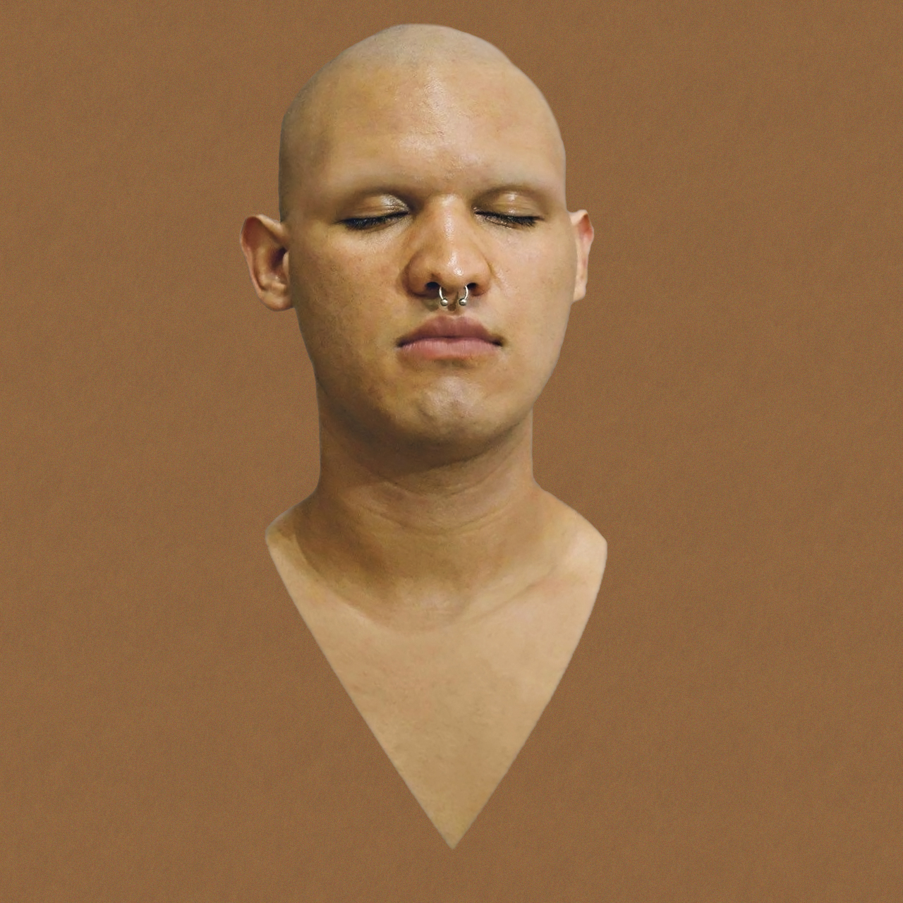
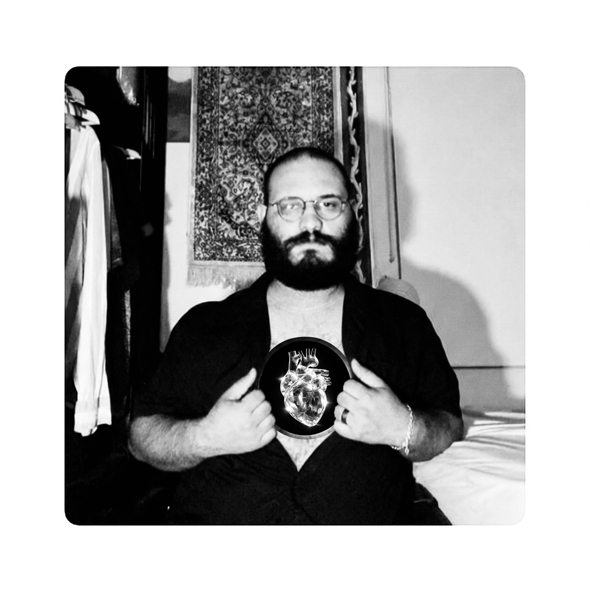

<link rel="preconnect" href="https://fonts.googleapis.com">
<link rel="preconnect" href="https://fonts.gstatic.com" crossorigin>
<link href="https://fonts.googleapis.com/css2?family=EB+Garamond:ital,wght@0,400..800;1,400..800&display=swap" rel="stylesheet">

> _Legenda para todos verem: um busto masculino sem qualquer pelo de olhos fechados contra um fundo com o mesmo tom de pele. O busto é meu._

# Rfz - O Espírito Zombeteiro

> “Então escrever é o modo de quem tem a palavra como isca: a palavra pescando o que não é palavra. Quando essa não-palavra —a entrelinha —morde a isca, alguma coisa se escreveu. Uma vez que se pescou a entrelinha, poder-se ia com alívio jogar a palavra fora. Mas aí cessa a analogia: a não palavra, ao morder a isca, incorporou-a. O que salva então é escrever distraidamente.” - Clarice Lispector, Água Viva

## Índice

1. [Caro Leitor](#caro-leitor)
2. [Textos](#textos)
3. [Verso & Poesia](https://lacra.ia.br/rafzmilhomens/)
4. [Correio Elegante](#correio-elegante)

## Caro leitor

Sou comunicólogo e faço um monte de coisas, mas minha área não é a filosofia. Entrei pro grupo Filosofia-Net logo no começo, pois aprender e conhecer é minha paixão. Especialmente quando se faz isso em grupo.
{: .capitular}

Meus textos devem passar por muitos assuntos, pois eu sou meio de ter visão aérea sobre muitas coisas. Espero, de coração, que com a ajuda dos meus colegas do grupo eu possa entregar raciocínios ao menos de fácil compreensão e que lhes agrade o conteúdo aqui.

Forte abraço.

P.S.: para me conhecer melhor, você pode acessar [minha página](https://rafaelmmilhomens.com).
## Textos

> Não tão filosóficos, mas ainda reflexivos

1. [Kit De Socorros](Kit_De_Socorros)
	1. Guia para publicar no Filosofia-Net
2. [A Tecnologização Do Sagrado E A Crise Do Indivíduo Contemporâneo](RFZ_A_Tecnologização_do_Sagrado_e_a_Crise_do_Indivíduo_Contemporâneo)
	1. Algaravias bruxuleantes sobre a ideia de colocar um copo d'água na frente da TV para ser abençoado
3. [O Gênero Documental Como Discurso Científico - Educação E Linguagem Audiovisual](RFZ_O_Gênero_Documental)
	1. Literacia midiática e sua urgência
4. [Para Que Serve A Filosofia? Sobre Os Privilégios Nas Torres De Marfim](RFZ_Para_Que_Serve_A_Filosofia)
	1. Uma viagem sobre nomes imagens, nomes imagens nomes.
5. [Um País Cristão - Brasil E O Cruzeiro Do Sul](RFZ_Um_País_Cristão)
	1. Acerca do que vemos e ignoramos

## [Verso & Poesia](https://lacra.ia.br/rafzmilhomens/)

> Para todos verem: um homem careca e barbudo com o peito aberto. No buraco há um coração vítreo. Sou eu sendo dramático

Também escrevo poesia. Mas em outro blog. Se você tiver interesse o título é o link para o blog. Só clicar. Talvez eu poetize melhor do que filosofe...
{: .capitular}

> "[...] Todo bairro tem um louco
> que o bairro trata bem
> só falta mais um pouco
> pra eu ser tratado também"
> Paulo Leminski

## Correio Elegante

>Recebo o crack, colante, dinheiro parco, embrulhado em papel carbono e barbante, até cabelo cortado, retrato de 3x4, pra batizado distante, recebo até, meu senhor, uma carta de amor

Quer falar comigo? Eu também quero falar com você! Temos muito o que conversar...
{: .capitular}

Meu e-mail: rafzmilhomens@proton.me