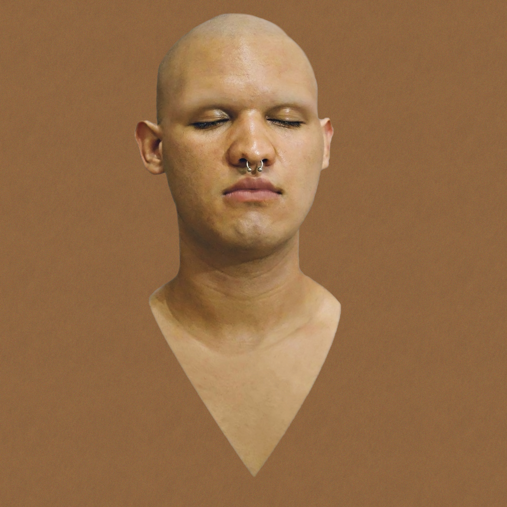

# RFZ - O Espírito Zombeteiro

> _Legenda para todos verem: um busto masculino sem qualquer pelo de olhos fechados contra um fundo com o mesmo tom de pele. O busto é meu._

Caro leitor,

Sou Rfz. Um preto norte, americano forte com um brinco de ouro na orelha... Brincadeira. Sou apenas um rapaz latino americano sem dinheiro no banco.

Sou comunicólogo e faço um monte de coisas, mas minha área não é a filosofia. Entrei pro grupo Filosofia-Net logo no começo, pois aprender e conhecer é minha paixão. Especialmente quando se faz isso em grupo.

Meus textos devem passar por muitos assuntos, pois eu sou meio de ter visão aérea sobre muitas coisas. Espero, de coração, que com a ajuda dos meus colegas do grupo eu possa entregar raciocínios ao menos de fácil compreensão e que lhes agrade o conteúdo aqui.

Forte abraço,

RFZ

Post Scriptum: para me conhecer melhor você pode acessar [https://rafaelmmilhomens.com](https://rafaelmmilhomens.com)

# Textos

0. [Kit De Socorros](Kit_De_Socorros)
1. [A Tecnologização Do Sagrado E A Crise Do Indivíduo Contemporâneo](A_Tecnologização_do_Sagrado_e_a_Crise_do_Indivíduo_Contemporâneo) 