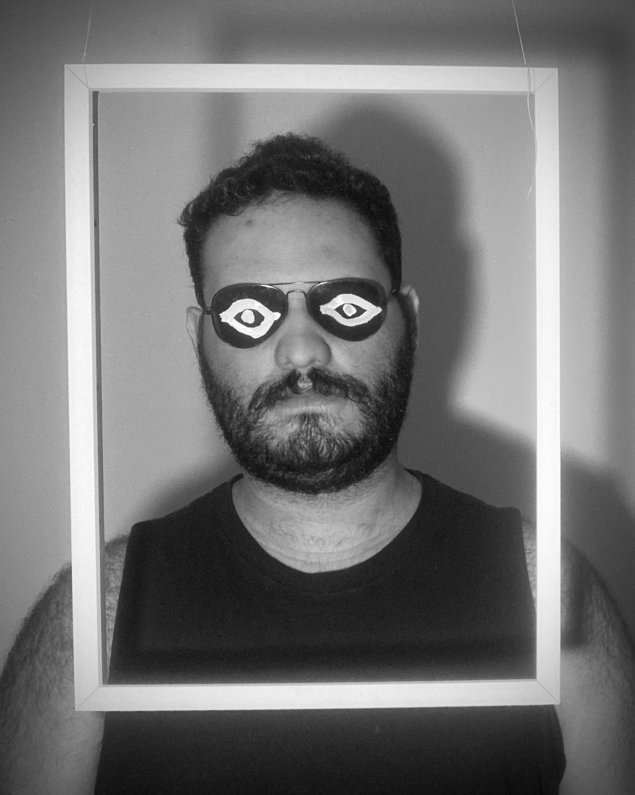

<link rel="preconnect" href="https://fonts.googleapis.com">
<link rel="preconnect" href="https://fonts.gstatic.com" crossorigin>
<link href="https://fonts.googleapis.com/css2?family=EB+Garamond:ital,wght@0,400..800;1,400..800&display=swap" rel="stylesheet">

> Para todos verem: um homem adulto com olhos desenhados em uma armação de óculos escuros em seu rosto por detrás de uma moldura vazia.

# O Gênero Documental Como Discurso Científico - Educação E Linguagem Audiovisual[^1]

## Sumário

1. [Preâmbulo](#preâmbulo)
2. [Fotografia como representação da realidade](#fotografia-como-representação-da-realidade)
3. [Moana e Nanook](#moana-e-nanook)
4. Realidade/Ficção
5. Cinema e audiovisual como linguagem e cultura
6. Possíveis formas de interpretação do discurso da obra audiovisual
7. Conclusão

## Preâmbulo

Hoje, diversas mídias permeiam o quotidiano social: Videogames/consoles, rádio, televisão, celular, computadores. E as diversas naturezas dos produtos que esses suportes reproduzem: vídeos digitais, _blue-rays,_ CD’s, vinis, fitas K-7, revistas em quadrinhos, impressas ou não, a internet e suas diversas plataformas. A relação dos sujeitos com esses meios contribui para com a maneira como enxergam o mundo e a cultura da qual fazem parte, suas referências imagéticas e sonoras, também no que se acredita, bem como os assuntos com os quais se preocupam. É comum que se diga que já se conhece um lugar porque se viu na televisão, por exemplo. Ou, que se defenda um ponto de vista à partir do que se viu em um documentário.
{: .capitular}

Considerando que na História, hábitos ressoam ao longo dos séculos, pode-se dizer que os meios contemporâneos e a linguagem da qual se utilizam são herança do Cinema que, por sua vez, é herança da fotografia. Com a evolução da linguagem cinematográfica, nem toda obra audiovisual é cinematográfica, contudo é possível que estes produtos carreguem em si muito da linguagem desenvolvida pelo Cinema desde os irmãos Lumiére e mesmo antes disso. De modo que talvez seja possível analisar também esses produtos através do estudo sistemático dessa linguagem. Buscando interpretá-los das formas que lhes cabem, elevando sua inteligibilidade em seu processo de leitura e feitura.

Desse modo, das obras audiovisuais e cinematográficas possíveis, o gênero cinematográfico documentário, isto é, aquele que remonta às origens do Cinema, produzidos por volta de 1920, em película, foi escolhido como objeto para descrever e exemplificar a fé do indivíduo no discurso audiovisual. Tornando-o objeto sensível na construção social, tendo em vista os desdobramentos que esse discurso gera no sujeito. Tal como a publicação científica, quando dotada de elementos que a tornem válida para a comunidade.

Este trabalho se utiliza da leitura de Bazin e Grierson, também artigos acadêmicos e teses de comunicólogos e estudiosos da linguagem, como Martino, Bosco Medeiros e historiadores, como Santiago Santos, a fim de justificar o produto audiovisual, qualquer que seja, como objeto comunicacional e dotado de linguagem, portanto interpretável e passível de análise.

Tratar-se-á da relação humano-imagem, a partir do que defende Bazin, em “A ontologia da imagem fotográfica”. Do nascimento do gênero Documentário, a partir de Grierson, no artigo que descreve Moana de Flaherty, utilizando a palavra Documentário pela primeira vez. Do problema realidade/ficção, e do Cinema e do Audiovisual, como linguagem, o Cinema pai do Audiovisual, a partir de Martino, em “De qual comunicação estamos falando?”. E possíveis formas de interpretação do discurso da obra audiovisual a partir de João Bosco Medeiros em “redação científica”.

## Fotografia Como Representação Da Realidade

Em a “Ontologia da imagem fotográfica”, Bazin explica que a imagem tinha a função de vencer o tempo, embalsamar o que estava sendo retratado, para que assim, o sujeito representado, pudesse vencer a morte ou uma segunda morte, a de cair no esquecimento. Com o passar do tempo, a arte foi destituída de suas funções mágicas e libertada do utilitarismo antropocêntrico e passou a criar universos que têm como índice o real.
{: .capitular}

Os pintores se dedicavam a representar o real da maneira mais fiel possível. Em dado momento, especializaram-se em um trabalho equilibrado entre a representação do real e o simbolismo das formas. Após a câmera fotográfica, a reprodução técnica “perfeita” do mundo real, a arte enfrentou uma crise espiritual e técnica.

O que nos interessa aqui, é que a certa altura, Bazin afirma que a fotografia tem valor indicial, isto é, se aquilo representado ali foi fotografado, então aquilo existiu em algum momento.

> “A objetividade da fotografia confere-lhe um poder de credibilidade ausente de qualquer obra pictórica. Sejam quais forem as objeções do nosso espírito crítico, somos obrigados a crer na existência do objeto representado, literalmente representado, quer dizer, tornado presente no tempo e no espaço. A fotografia se beneficia de uma transferência de realidade da coisa para a sua reprodução. O desenho o mais fiel pode nos fornecer mais indícios acerca do modelo; jamais ele possuirá, a despeito do nosso espírito crítico, o poder irracional da fotografia, que nos arrebata a credulidade” Bazin e o cinema: ensaios p. 23

A fotografia não é Cinema, mas matéria prima para tal. É importante considerar que essa matéria prima ainda, nos tempos de hoje, nos arrebata a credulidade e “re-presenta” ou seja, torna presente, algo que não está lá. Tal qual a escrita e o alfabeto, quando constitui palavra com sentido. É preciso dizer também que essa matéria constitui parte menor de uma linguagem, tal qual o alfabeto.

Temos fotografias nas carteiras de identidade, nos álbuns de família, nas revistas de moda e de pesquisas geográficas, fotografias de grandes telescópios que “comprovam” a existência de outras galáxias, estrelas ou nebulosas. Para Bazin, o Cinema é “a consecução no tempo da objetividade fotográfica […] a imagem das coisas é também a imagem da duração delas…”.

## Moana E Nanook

Pouco antes de Bazin publicar seu “Ontologia da imagem”, Flaherty lançava os filmes Nanook (1992) e logo após Moana (1926). Ambos os filmes tratam da vida de personagens não fictícios, isto é, Nanook e Moana de fato existiram. Flaherty narra as conquistas e derrotas de ambos em grandes cenas de luta, dança, caça e festa, intermediado por letreiros que narram a história de forma poética. Moana, foi o primeiro filme a ser descrito como documentário, por Jhon Grierson, sociólogo interessado em cinema.
{: .capitular}

> “Evidentemente, sendo _Moana_ uma descrição visual dos acontecimentos na vida quotidiana de um jovem polinésio e da sua família, possui valor enquanto documentário. Mas isso, acredito, é secundário em relação ao seu valor enquanto uma doce respiração de uma ilha iluminada pelo sol, banhada por um maravilhoso mar tão quente como o suave ar. _Moana_ é, antes de mais, belo como a natureza é bela. É belo porque os movimentos do jovem Moana e dos outros polinésios são belos, e porque as árvores e a rebentação das ondas, as nuvens suavemente encapeladas e os distantes horizontes são belos.” Grierson, A poética de Moana, de Flaherty p. 19. Tradições Reflexões.

Ambos os filmes foram de grande sucesso de bilheteria, por tratarem da documentação da vida exótica de um esquimó e um indígena. E pode-se ter, pela nota de Grierson, que naquela época as imagens ali tinham a função e o valor de descreverem o real, demonstrar uma realidade distante dos espectadores, ou seja, valer como uma narrativa descritiva ou instrutiva a respeito da cultura nas quais esses personagens estavam inseridos.

## Realidade/Ficção

No entanto, os filmes constavam de alguns problemas, o Nanook retratado, por exemplo, era na verdade um ator, bem como sua esposa. Muitas das práticas retratadas tanto em Moana quanto em Nanook já não eram praticadas na época em que os filmes foram lançados. As opções de montagem, ritmo e angulação dos planos também sugerem histórias épicas para aqueles personagens. O que coloca os temas “verdade” e credulidade, levantados por Bazin, do filme e da obra documental em questão.
{: .capitular}

Tendo em vista que a linguagem fílmica dá opções de ângulos de câmera e estilos de narrativa, por vezes um documentário beira a ficção. A linha é tênue. Referências de datas absolutamente distantes do tempo em que foi filmado e que diretor, roteirista ou qualquer pessoa da equipe poderia ter testemunhado também são um fator importante no resultado do produto documental.

## Cinema E Audiovisual Como Linguagem E Cultura

Mas se considerarmos a obra fílmica e a imagem não como retrato fiel da realidade, mas como interpretação que o diretor fez dela. Assim, pode-se ter aquilo como um discurso construído a partir da perspectiva de alguém. Já não é importante saber se aquelas imagens são “reais”, mas o que elas representam. O roteiro é majoritariamente escrito e verbal e, atualmente, elemento comum a qualquer produto audiovisual. Assim como a linguagem escrita, a linguagem audiovisual também tem suas raízes na linguagem verbal, trata de conceitos e aproximações e pode referir-se a si mesma.
{: .capitular}

Se observarmos com cautela, podemos traçar um paralelo entre o que a imagem é para a linguagem cinematográfica e o que são as letras so alfabeto para a linguagem escrita. Ambas, tanto a escrita quanto a cinematográfica, podem ser moduladas em discursos e restringidas em gêneros. Pode-se escrever poesias, cartas, romances ou artigos científicos com palavras e do mesmo modo, pode-se fazer filmes de ação, de drama, terror ou documentários. Embora, à exceção do documentário, grande parte dos gêneros cinematográficos possam ser tidos como contação de histórias, na linguagem audiovisual, que vem do cinema, pode-se produtos com narrativas inclusive instrucionais.

Martino em “De qual comunicação estamos falando?” p.4, apresenta o já conhecido esquema do processo comunicacional:

> […] Emissor (quem envia a mensagem), Receptor (quem a recebe), o Canal ou meio (pela qual ela é enviada), o Efeito que ela provoca (social, individual) e a mensagem, que designa aquilo que é propriamente enviado do emissor ao receptor, pressupondo conter a intenção do primeiro e sofrendo a interpretação do segundo.”

E esclarece que esses termos designam a comunicação de modo relativo. Para que essas coisas possam ser comunicação elas precisam ser tomadas em relação àqueles que a entendem como tal. Para um falante de Português não familirizado com o japonês, “私はあなたを大好きです” pode não significar nada se escrito em um papel. De modo que mensagens e significações são manifestações dadas no domínio simbólico, construções culturais. Tal como a língua daquela região. Portanto, a obra audiovisual, apesar de transmitir mensagens não necessariamente será interpretada da mesma forma à todas as pessoas.

## Possíveis Formas De Interpretação Do Discurso Da Obra Audiovisual

Dentre as várias problemáticas e técnicas para ler um texto científico levantadas por João Bosco Medeiros em seu livro “Redação científica” algumas delas também poderiam se aplicar à “leitura” de uma obra cinematográfica, mais especificamente de um documentário:
{: .capitular}

> “A leitura é seletiva e que há vários modos de realizá-la, como: O que é relevante para o leitor é a relação do texto com o autor (o que o autor quis dizer?); relação do texto com outros textos (leitura comparativa); o que é relevante é a relação do texto com seu referente; relação do texto com o leitor (o que você entendeu?).” João Bosco Medeiros, Redação científica: a prática de fichamentos, resumos, resenhas. p. 56

Fábio Santiago Santos afirma em “O filme na história cultural: Caminhos e possibilidades” que o filme é “capaz de reforçar identidades e disseminar imagens e ideias em função de interesses de grupos, classes e indivíduos particulares, o que denota o caráter do cinema como “fenômeno complexo em que se entrecruzam fatores de ordem estética, política, econômica ou social.”

De modo que tal como qualquer obra comunicacional, a obra audiovisual é polissêmica e passível de diversas interpretações, mas assim como a linguagem verbal, pode ser ensinada e interpretada através de diversos vieses. Uma vez que é linguagem.

Retomando o paralelo entre o artigo científico e o documentário. Para João Bosco Medeiros, um artigo científico “trata de problemas científicos, embora de extensão relativamente pequena. Apresenta o resultado de estudos e pesquisas. E, em geral, é publicado em revistas, jornais ou outro periódico especializado.”. João Bosco Medeiros p. 203. Pode-se dizer que o artigo científico assume diversos vieses como analíticos, classificatórios ou argumentativos, assim como o documentário, mas se valendo do uso de sons, imagens e linguagem escrita (roteiro). Poderia-se dizer, portanto, o mesmo de um documentário, excetuando apenas o meio onde é exibido ou publicado.

## Conclusão

Atualmente, a fotografia já não é matéria prima para o Cinema e o audiovisual, já se tem diversos meios de produção de imagens que não utilizam a fotografia, tal como 3D e animações. Há ainda efeitos de corte, cópia, colagem, bonecos, massa de modelar, jogos de luz. Portanto, há também documentários como Valsa com Bashir e Persépolis que, à exceção do final de Valsa com Bashir, não constam fotografias em suas composição, mas ainda tem valor documental e constituem discursos de seus diretores. É difícil afirmar que imagens hoje representam índices da realidade, no entanto ainda comunicam mensagens, algumas com alcance que extrapolam as fronteiras dos idiomas, afinal é grande o percentual de indivíduos que compreende som e imagem.
{: .capitular}

Essa abstração da imagem enquanto transmissora de conceitos não impede que se estabeleçam técnicas e métodos formais de estudo para interpretação dessas obras audiovisuais. De modo que, um documentário fala tanto do seu autor quanto um artigo acadêmico e, no entanto, isso não invalida as contribuições dessas obras para o desenvolvimento de uma reflexão ou da ciência de um campo, propriamente dita.

Documentário é apenas um dos vários gêneros que uma obra audiovisual pode assumir, tal como artigo científico é um dos vários gêneros da linguagem escrita. Portanto, o estudo dessas linguagens é na verdade muito vasto, uma vez que há produtos audiovisuais como GIFs, gravações de câmeras de segurança, animações, jogos de videogame, realidade aumentada, realidade virtual, reportagens jornalísticas, podcasts, musicas, cada um com seus subgêneros, intenções e interpretações.

Faz-se necessário, portanto, o desenvolvimento de uma ferramenta que sistematize os elementos básicos da linguagem ausiovisual, tal como a gramática para as letras. Tendo em vista a permeabilidade dessa linguagem na vida contemporânea.

Rfz

publicado pela primeira vez em 01/04/2018 - Brasília - DF

[^1]: Rfz é pesquisador independente baseado em Brasília, Brasil. Bacharel em Comunicação – Audiovisual (Universidade de Brasília – UnB). Interesses de pesquisa incluem sistemas simbólicos pós-seculares, semiótica, teoria cultural, e os mecanismos pelos quais tecnologias de sentido organizam a percepção coletiva. Atualmente desenvolvendo o conceito de “**Purificação Simbólica**”: uma matriz para compreender como sistemas simbólicos dominantes sobrescrevem outros enquanto apresentam-se como neutros (rafzmilhomens@proton.me).
